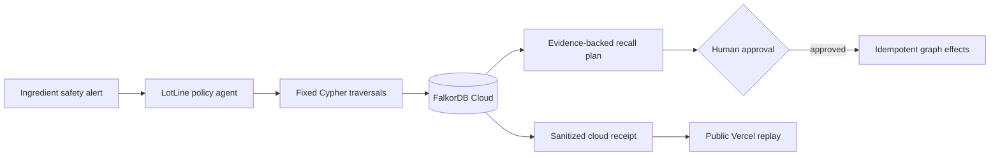

# LotLine

**Trace wider. Recall narrower.**

[Live demo](https://lotline-ai.vercel.app) · [Public cloud receipt](https://lotline-ai.vercel.app/evidence/cloud-demo-run.json) · [Graph Hacks](https://www.wemakedevs.org/hackathons/falkordb)

LotLine is a graph-native food-recall agent for food-safety and recall teams. Given an alert for an ingredient lot, it follows direct ingredient lineage and shared-line production adjacency, applies validated cleaning as a stopping rule, proposes only graph-supported actions, waits for human approval, and records idempotent effects.

The submission targets **Agents That Act on Connected Data**.

## The problem

Recall teams need to answer two questions quickly and defensibly:

1. Which finished lots can the flagged ingredient reach, directly or through cross-contact?
2. Where should propagation stop so safe lots are not recalled unnecessarily?

Those answers live across ingredient lots, production runs, lines, cleanings, shipments, and destinations. Flattening those relationships into independent lookups makes multi-hop exposure reasoning and evidence reconstruction fragile.

## Why FalkorDB is load-bearing

FalkorDB is the decision surface, not a visualization layer. LotLine's core result comes from Cypher traversals over the relationship graph:

- direct lineage: alert → ingredient lot → production run → product lot;
- adjacent exposure: source run → shared line → later run within the policy window;
- stopping rule: a validated cleaning between runs excludes later lots;
- distribution scope: affected lot → shipment → destination;
- action evidence: recall case → evidence → proposed action → effect.

Remove `USED_IN` from the flagged ingredient to its production run and the agent can no longer reach the direct lots. That dependency is covered by a regression test.

## Verified result

The retained FalkorDB Cloud graph is `lotline_proof_20261017_002910`. The public interface reads the sanitized receipt in [`evidence/cloud-demo-run.json`](evidence/cloud-demo-run.json); it does not duplicate the result in presentation-only JavaScript.

| Observed property | Verified result |
|---|---:|
| Affected product lots | 3 |
| Safe product lots spared | 7 |
| First execution effects | 5 |
| New effects on replay | 0 |
| Final case state | `COMPLETED` |

The affected set is `LOT-GRANOLA-101`, `LOT-GRANOLA-102`, and cross-contact lot `LOT-BITES-201`. A validated cleaning stops propagation before `LOT-GRANOLA-103`.

## Judge path

1. Open the [live demo](https://lotline-ai.vercel.app).
2. Select **Replay cloud trace**.
3. Inspect the direct and shared-line evidence paths.
4. Approve as `OP-001`.
5. Execute the recorded actions and observe zero new effects on replay.
6. Open **Cloud receipt** to inspect the machine-readable FalkorDB result.

The hosted UI is a credential-free replay of a real cloud execution. A database password is never shipped to the browser, and the unauthenticated public site cannot mutate the cloud instance.

## Architecture



The agent is deterministic: the graph supplies connected context, policy code defines the exposure boundary, and the operator controls execution. No language model is trusted to invent a path or authorize an effect.

## Graph data model

```text
(Supplier)-[:PRODUCED]->(IngredientLot)
(IngredientLot)-[:USED_IN]->(ProductionRun)
(ProductionRun)-[:RAN_ON]->(Line)
(Line)-[:HAD_CLEANING]->(CleaningEvent)
(ProductionRun)-[:CREATED]->(ProductLot)
(ProductLot)-[:IN_SHIPMENT]->(Shipment)
(Shipment)-[:DELIVERED_TO]->(Location)
(Alert)-[:FLAGS]->(IngredientLot)
(RecallCase)-[:AFFECTS]->(ProductLot)
(RecallCase)-[:HAS_EVIDENCE]->(Evidence)
(RecallCase)-[:HAS_ACTION]->(Action)
(Action)-[:SUPPORTED_BY]->(Evidence)
(Operator)-[:APPROVED]->(Action)
(Action)-[:PRODUCED]->(Effect)
```

The fixed production queries are in [`lotline/cypher.py`](lotline/cypher.py). The real cloud adapter and state transitions are in [`lotline/cloud_backend.py`](lotline/cloud_backend.py).

## Run the public proof locally

Requirements: Node.js 24 and Python 3.11 or newer.

```powershell
npm run check
npm run build
python -m http.server 8765 --directory dist
```

Open `http://127.0.0.1:8765`. This serves the same credential-free cloud receipt used by the Vercel deployment.

## Run the verification suite

```powershell
python -m unittest discover -s tests -v
python scenario_benchmark.py --write
```

The scenario benchmark covers:

- high-severity direct and shared-line exposure;
- medium-severity review-only adjacency;
- an adjacent run outside the 60-minute window;
- an unvalidated cleaning that must not stop propagation;
- a removed load-bearing lineage edge;
- approval enforcement and idempotent replay.

Its machine-readable output is [`evidence/scenario-benchmark.json`](evidence/scenario-benchmark.json). These adversarial scenarios use the deterministic test adapter and are explicitly marked `MOCKED`; the primary end-to-end receipt is `REAL — CLOUD`.

## Run against FalkorDB Cloud

No Docker installation is required.

```powershell
python -m venv .venv
.\.venv\Scripts\Activate.ps1
pip install -r requirements-falkordb.txt
Copy-Item .env.example .env
```

Put a fresh FalkorDB Cloud connection URL in the ignored `.env` file, then run:

```powershell
python run_cloud.py
```

The command creates a fresh proof graph, executes trace → approval → effects → replay, asserts the expected boundary and idempotency result, and rewrites `evidence/cloud-demo-run.json`. See [`CLOUD.md`](CLOUD.md) for configuration details.

To run the interactive UI directly against a configured cloud graph:

```powershell
python -m lotline.api_cloud
```

Keep this server bound to localhost. It has no production authentication or rate limiting.

## Execution truth table

| Capability | Status | Evidence |
|---|---|---|
| FalkorDB connection and Cypher traversal | `REAL — CLOUD` | `evidence/cloud-demo-run.json` |
| Approval and idempotent effects in the retained graph | `REAL — CLOUD` | first run: 5 new; replay: 0 new |
| Public interface | `REAL — CLOUD` hosting | public Vercel deployment |
| Public interaction | `REAL — CLOUD` evidence playback | loads the retained receipt at runtime |
| Safety-scenario regression suite | `MOCKED` graph dependency | `evidence/scenario-benchmark.json` |
| Source supply-chain data | `MOCKED` | synthetic Northstar Foods fixture |
| Quarantine outcome | `SIMULATED` | product-lot status changes in the graph only |
| Notification outcome | `SIMULATED` | notification-task record only; no email or SMS |

## API

The local proof APIs expose:

- `GET /health`
- `POST /v1/seed`
- `POST /v1/alerts/analyze`
- `GET /v1/cases/{case_id}`
- `POST /v1/cases/{case_id}/approve`
- `POST /v1/cases/{case_id}/execute`

The public Vercel deployment deliberately exposes only static assets and the sanitized receipt.

## Security and limitations

- Cloud credentials belong only in ignored environment files.
- The public deployment contains no database credential and no mutation endpoint.
- Synthetic data is used throughout; no private operational data is included.
- LotLine does not validate supplier statements, predict contamination, send regulatory notices, or replace a qualified food-safety operator.
- The localhost cloud API is a demonstrator, not an authenticated production service.
- Concurrent execution and partial external-system failure remain unverified.

See [`SECURITY.md`](SECURITY.md) and [`docs/build-harness/`](docs/build-harness/) for the threat model, invariants, evidence map, test plan, and submission audit.

## AI assistance disclosure

AI coding assistants were used during implementation and documentation. The participant directed the work, reviewed the architecture and code, ran the verification steps, and remains responsible for understanding and presenting the submitted system.

## License

MIT — see [`LICENSE`](LICENSE).
