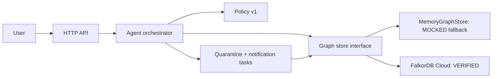

# Architecture

## System thesis

LotLine separates graph facts, safety policy, orchestration, and effects. A state-machine agent chooses fixed graph tools, a deterministic policy produces the plan, and no effect executes without operator approval.

## Components

| Component | Responsibility | Trust |
|---|---|---|
| API | Validate requests and expose cases | Semi-trusted boundary |
| Agent | Analyze, request approval, execute, inspect | Trusted orchestration |
| Policy | Direct/shared-line rules | Trusted deterministic code |
| MemoryGraphStore | Local graph semantics and evidence | MOCKED test runtime |
| FalkorDB Cloud adapter | Real traversal, state, evidence, approval, effects | VERIFIED on retained proof graph |

## State model

`NEW → AWAITING_APPROVAL → APPROVED → COMPLETED`, with execution rejected before approval.

## Failure behavior

- Unknown ingredient lot: fail with validation error.
- Unknown operator: deny approval.
- Execution before approval: deny execution.
- Duplicate execution: return existing effects; create none.
- Graph runtime unavailable: do not silently call the mocked adapter “FalkorDB.”
- Public deployment: serve sanitized evidence playback; keep the credentialed mutation API private until authentication and rate limiting exist.

## Constraints

- No model-generated Cypher.
- No unapproved external action.
- No action without graph evidence.
- Synthetic data must stay labeled.
